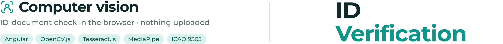
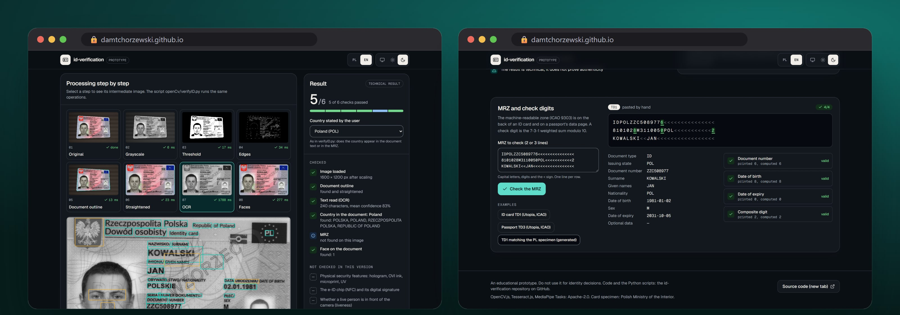
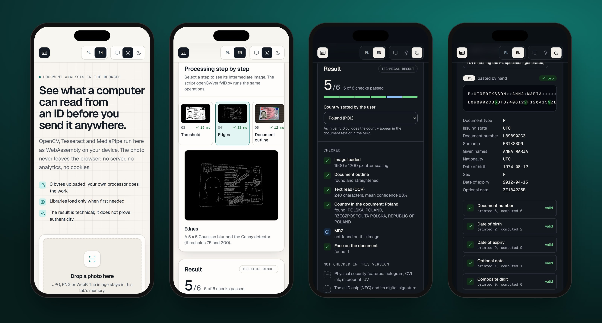
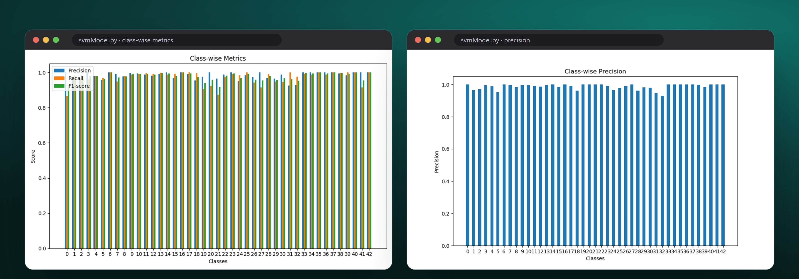

<p align="center">
  <picture>
    <source media="(prefers-color-scheme: dark)" srcset="docs/images/banner-dark.png">
    
  </picture>
</p>

<p align="center">
  
</p>

## About

<a href="https://damtchorzewski.github.io/id-verification/"></a>

**id-verification** shows what a computer can read from a photo of an identity document, step by step, **without
sending the photo anywhere**. The web demo (Angular) runs OpenCV, Tesseract OCR and MediaPipe face detection as
WebAssembly in the browser; there is no server, no analytics and no cookie. Next to it are the original Python scripts
(OpenCV preprocessing, a Tesseract text match, Haar-cascade face detection and an SVM experiment) that the demo grew
out of.

- **A pipeline you can inspect.** Drop a photo, take one with the rear camera, or use the specimen. Eight steps, each
  with its intermediate image and time: the original (scaled to 1600 px), grayscale, a binary threshold (Otsu or a
  manual value, with the 3 × 3 morphological opening of `verifyID.py`), Canny edges (75 / 200, as in
  `imageTransform.py`), the document outline (the largest convex quadrilateral over 20% of the frame), the card
  straightened to the ID-1 shape (85.6 × 54 mm), OCR with word boxes, and faces.
- **OCR (Tesseract.js 7).** Polish and English LSTM models in sparse-text mode (PSM 11) on the straightened grayscale
  card: the mode and the source that read the most fields of the specimen. The source image can be switched
  (grayscale, colour, thresholded).
- **MRZ and ICAO 9303 check digits.** Finds a TD1 (ID card), TD2 or TD3 (passport) zone in the OCR text, in a second
  OCR pass over the bottom band with only MRZ characters allowed, or in a zone pasted by hand. Every field is parsed
  and every check digit (weights 7-3-1, modulo 10) is recomputed and marked in place; the expiry date and the match
  between the zone and the printed front (number, surname) are checked too. Examples: the two ICAO specimens (Utopia)
  and a TD1 zone generated for the Polish specimen.
- **Declared country.** The check of `verifyID.py`, a little less naive: the country's names, the nationality word
  printed on cards and the ICAO code, in the OCR text and in the MRZ.
- **Faces (MediaPipe BlazeFace).** Found on the straightened card, with crops and confidence.
- **An honest result card.** Every check with its status (passed, failed, warning, info) and, always, what is _not_
  checked: physical security features, the e-ID chip, liveness, matching the face to a person, registers of revoked
  documents, signs of editing. A JSON report (results and text, no images) can be downloaded.
- **Private by construction.** Every library, model and language file is served by the site itself (copied from the
  locked `node_modules` at build time), the Content Security Policy allows no other host, and an end-to-end test
  records every request of a full analysis: all of them go to the site and none carries a body. The runtimes download
  only when first needed (before compression: OpenCV.js up to 11 MB, Tesseract with both languages up to 10 MB,
  MediaPipe up to 14 MB).
- **The Python scripts (`openCv/`).** `verifyID.py` reads the photo with Tesseract after a threshold and checks that
  the declared country appears in the text (`ID OK` / `Invalid ID`); `imageTransform.py` does grayscale, crop, rotate,
  Canny and Haar-cascade face detection; `svmModel.py` trains an `SVC` on the GTSRB traffic signs (a separate
  experiment, plotted below).

Polish and English, light and dark theme, phone to desktop, keyboard and screen-reader friendly, checked with axe for
WCAG 2.2 AA in both themes.

> **Status:** a prototype of image processing, not an identity-verification system. It does not prove that a document
> is genuine or that it belongs to the person showing it: anyone can compute check digits, and none of the checks
> listed as not checked is done. The samples are the published WZORZEC specimen of the Polish identity card (the front;
> its MRZ is on the back, so the demo reports the zone as not found) and an angled photo made from it. Use specimens
> only, never a real person's document, when you show the demo.

## Tech stack

|         |                                                                                                            |
| ------- | ---------------------------------------------------------------------------------------------------------- |
| Stack   | Angular 22 (standalone components, signals, zoneless), TypeScript 6, built with `@angular/build` (esbuild) |
| UI      | Tailwind CSS 4 (`oklch` and `light-dark()` tokens), Geist and Geist Mono (Fontsource), Lucide icon paths   |
| Vision  | OpenCV.js 4.12 in a Web Worker; MediaPipe Tasks Vision (BlazeFace short range); WebAssembly                |
| OCR     | Tesseract.js 7 with `tesseract.js-core` and the `pol` / `eng` best-int models, all self-hosted             |
| Scripts | Python 3: OpenCV, pytesseract, scikit-learn, pandas, NumPy, matplotlib                                     |
| Tests   | Vitest (MRZ, country match, report); Playwright with axe (flows, privacy, WCAG 2.2 AA, desktop and phone)  |
| Hosting | GitHub Pages, deployed by GitHub Actions from `main`                                                       |

The interface is Polish and English; the code, comments, README, commits and branches are in English (some comments in
the Python scripts are Polish).

## Screenshots

On the left the OCR step in the dark theme with its word boxes, on the right the MRZ panel checking the zone generated
for the specimen; then the demo on phones (home, the edges step, the result card, the TD3 passport specimen).

<p align="center">
  
</p>

<p align="center">
  
</p>

The SVM experiment of `svmModel.py`: class-wise metrics and precision on GTSRB, as saved in `openCv/path/`.

<p align="center">
  
</p>

## Quick start

```bash
git clone https://github.com/DamTchorzewski/id-verification.git
cd id-verification
# the web demo
pnpm install
pnpm dev                            # http://localhost:4200/
# the Python scripts (from the repository root)
pip install opencv-python pytesseract numpy pandas scikit-learn joblib matplotlib
python openCv/verifyID.py           # needs Tesseract OCR installed
python openCv/imageTransform.py     # a window per step; press a key to continue
```

Requirements: Node 22 (`.nvmrc`) and pnpm 11 (`packageManager`) for the demo; Python 3 and Tesseract for the scripts.
`verifyID.py` expects Tesseract at `C:\Program Files\Tesseract-OCR\tesseract.exe` (set in the script) and checks the
declared country `Poland` against `openCv/path/image.jpg`.

## Scripts

| Command                           | What it does                                                                                    |
| --------------------------------- | ----------------------------------------------------------------------------------------------- |
| `pnpm dev`                        | the demo with hot reload (`ng serve`)                                                           |
| `pnpm build` / `pnpm preview`     | build to `dist/` with the CSP and `404.html`; serve it as Pages does, under `/id-verification/` |
| `pnpm check`                      | format check, lint (with the Angular template accessibility rules), types, unit tests           |
| `pnpm test` / `pnpm test:e2e`     | Vitest; Playwright against the production build                                                 |
| `pnpm health`                     | check the live site and every runtime file (`SITE_URL=...`); runs after every deploy            |
| `python openCv/verifyID.py`       | OCR of the document photo and the country check                                                 |
| `python openCv/imageTransform.py` | grayscale, crop, rotate, edges and face detection on the sample image                           |
| `python openCv/svmModel.py`       | train and evaluate the traffic-sign SVM (needs GTSRB in `data/`)                                |

## Configuration

None: no environment variables, keys or `.env` file. The base path (`/id-verification/`) is `baseHref` in
`angular.json`, the self-hosted runtimes are its `assets` list, and the Content Security Policy is written by
`scripts/postbuild.mjs`. The Python scripts keep their settings at the top (the image path, the declared country, the
Tesseract path, the dataset path).

## Structure

```
web/src/main.ts, web/src/index.html       the demo's entry
web/src/app/app.ts                        ★ the page: header, hero, workspace, footer
web/src/app/services/analysis.store.ts    ★ the analysis as signals: steps, results, report, reset
web/src/app/pipeline.ts                   ★ the step list, the viewer, the threshold and OCR controls
web/src/app/result-card.ts, mrz-panel.ts  the result card; the MRZ panel
web/src/app/i18n.ts                       ★ every text, Polish and English
web/src/app/services/                     the OpenCV worker client, Tesseract, MediaPipe, image helpers
web/src/workers/vision.worker.ts          ★ the OpenCV steps
web/src/lib/                              ★ MRZ parser and check digits, country match, report (unit-tested)
web/public/                               the specimens, the face model, the favicon
tests/e2e/                                Playwright and axe
scripts/                                  postbuild (CSP), preview server, health check
openCv/                                   the Python scripts and the images they saved
docs/                                     documentation; docs/images/ holds the README images (generated)
```

## Branches and workflows

Shared standards from `reops/standards`: `main` ≤ `develop` ≤ a working branch `<type>/<topic>`, work PRs into
`develop`, release PRs into `main`, Conventional Commits in English (commitlint and lint-staged in husky hooks). Two
workflows: `ci.yml` (format, lint, types and unit tests, then the e2e tests on a pull request and on `main`) and
`deploy.yml` (CI, then the build; on `main` it publishes `dist/` to GitHub Pages and runs `pnpm health`). A change to
the documentation alone starts nothing.

**Departures from the standards (and why):**

- **No `weekly.yml`:** a static site with no external connection; `pnpm health` runs after every deploy.
- **No security headers beyond the CSP:** GitHub Pages sends no custom headers, so the policy is a `<meta>` tag (which
  cannot carry `frame-ancestors`), and the workers that run OpenCV and Tesseract get no policy of their own.
- **The Python scripts have no tests, hooks or dependency file:** they are kept as they were, a prototype.
- **The README logo is a wordmark** (the project has none).

## Documentation

| Document                                 | Covers                                                 |
| ---------------------------------------- | ------------------------------------------------------ |
| [docs/repository.md](docs/repository.md) | GitHub description, website and topics, Pages settings |

The README images (`docs/images/`) are regenerated with `tools/readme-images` (profile `id-verification`): shots of the
demo (a local `pnpm preview` through `SITE_URL`, or the live site) and the SVM plots in `openCv/path/`; the working
shots go to `.scratch/`.

---

<p align="center"><a href="https://damreboot.pl"><picture><source media="(prefers-color-scheme: dark)" srcset="docs/images/damreboot/company-dark.svg"></picture></a><a href="https://www.linkedin.com/in/damian-tchorzewski-3b2388275/"><picture><source media="(prefers-color-scheme: dark)" srcset="docs/images/damreboot/linkedin-dark.svg"></picture></a><a href="mailto:damianchabracki@gmail.com"><picture><source media="(prefers-color-scheme: dark)" srcset="docs/images/damreboot/email-dark.svg"></picture></a></p>

<p align="center">
  <picture><source media="(prefers-color-scheme: dark)" srcset="docs/images/damreboot/engineered-dark.svg"></picture> Engineered by <b>Damian Chabracki</b> (DamReboot IT)
</p>
